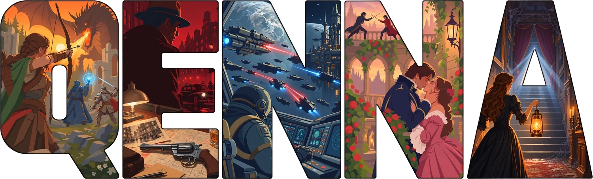

**Your temple of creativity.**

*(formerly Qiyva Writer, formerly Mira Writing)* 

Qenna Writer is a text editor and multi-document manager, built entirely
for the craft of creative writing.

### [⬇ Download the latest version](https://github.com/Pedrovskigg/Qenna-Writer-releases/releases/latest)

## NEW IN 1.5: THE MAP

Yes. Qenna Writer now has a map maker. And not just any map maker.

Generate a whole continent from a seed, or draw one by hand, exactly the way
your story demands. The terrain is real relief: there's no .png of a mountain
standing in for mountains here. **Your mountain really is a MOUNTAIN**, made
from the map's elevation. Altitude, latitude and humidity decide the climate
and the biome of every patch of ground, and the rivers, coasts and forests
follow from there.

Seriously, if Tolkien had seen this while writing LOTR, he'd have had a fit.

### Build on it

Castles in a dozen styles (human, Norman, moated, château, clifftop, elven,
dwarven, orc...), landmarks, legends, ships, sea monsters, and brushes that
paint whole cities and forests. Pick a piece, click where it goes. It sits on
the relief, and the hill in front hides what stands behind it.

### Your world, inside your map

Your map isn't just a visual reference. It's **interactive**, and it tells
**the story of your world**.

Every territory is a group in your project. Click it on the map and its
documents open right there: the laws, the roads, the people who live there,
readable and editable without leaving the map. Name a castle and it becomes a
place of its own, inside the kingdom. A royal family lives inside the castle;
a merchant guild can be marked as active in every territory it reaches. Drag
a document onto a group to move it there.

### Day, night, and every way to see it

The clock runs, and at night the windows, torches and lighthouses light up.
And when you want it to look like the map at the front of a book: Ink,
Parchment, Nautical chart, Topographic, Watercolor and War plan.

And also: maps from an island to a continent, several maps in the same
project, a ruler that measures distance and travel time, and **PNG export**
at 1×, 2× or 3×, ready for the book.

This is just the beginning. This tool will get even more turbocharged in the
next versions. Wait and see.

---

The market for writing software has become an expensive land grab —
countless options, lots of money involved, subscriptions, paywalls,
premium features. They charge you for things that should already be there,
for things your story deserves to have.

Going in the exact opposite direction, Qenna Writer exists to make this
craft democratic. Everyone should have the right to every tool they need to
write their stories — whatever those stories may be.

And that's where this program was born.

You shouldn't have to pay to write good stories, or pay for the tools that
help you write them. The only payment Qenna Writer asks for is: write good
stories.

Now let's talk about what it offers — and why you need it.

## Table of contents

- [New in 1.5: the Map](#new-in-15-the-map)
- [Create your project](#create-your-project)
- [The text editor](#the-text-editor)
- [Organize whatever you want](#organize-whatever-you-want)
- [Build, explore, and track your characters](#build-explore-and-track-your-characters)
- [Stay consistent with just a few clicks](#stay-consistent-with-just-a-few-clicks)
- [Build your story and your world](#build-your-story-and-your-world)
- [Manage your writing](#manage-your-writing)
- [Additional features](#additional-features)
- [Installing on Windows](#installing-on-windows)
- [Languages](#languages)
- [Source code](#source-code)

## Create your project

Set the title, genres, and cover. Choose what it is: a book or a
screenplay?

## The text editor

Fully personalizable and customizable, Qenna Writer's text editor is built
for more than just the basics. With Focus Mode, the editor becomes a
distraction-free, fully comfortable space designed for one thing only:
letting your ideas flow. No worries, no clutter.

It also offers a range of direct, precise tools for building your story.
Create annotations, leave comments, and even generate new documents
straight from your text. Add images, tag other documents for quick
reference with `@`, and much more.

## Organize whatever you want

Through drawers and document management, build and organize your project
exactly the way you envision it. In an intuitive interface, create and
write as many documents as you like. A drawer for characters? Settings?
Objects? Lore? Yes. All of it just a few clicks away, accessible anytime.

There's no limit to how many drawers or documents you can create. Organize
your documents into folders and subfolders, group documents from different
drawers together, and much more. The only limit is your imagination.

The Manuscript feature is where your story lives. Every chapter and scene
is searchable through the Reference Menu, so you always have exactly what
you need, right when you need it.

And on top of that... **Multiple Manuscripts**: is your project an entire
6-book saga? What if I told you that you could write that entire saga in
the SAME project, with full access to everything you've already written?
Need to find a detail mentioned in Chapter 3 of Book 2 while you're writing
Book 6? No problem. Use the search tools or jump straight to it through the
Reference Menu.

## Build, explore, and track your characters

Create character drawers, add images, nicknames, define relationships
between them, and describe who they are. The app takes care of the rest.

Through an automated system, the app can detect your characters' presence
across chapters and scenes, giving you participation graphs so you know
exactly how much each one appears.

Get instant access to everything your characters have ever said. The app
automatically logs every line of dialogue, giving you fast, reliable
recall whenever you need it. Never forget what they said — or where they
said it.

## Stay consistent with just a few clicks

Every single document in your project is accessible anytime through the
Reference Menu, letting you read and retrieve whatever you need in
seconds.

Speaking of consistency... the Pensarium is your best friend. Can't forget
something? Select the passage and save it as a memory. It's there whenever
you need to check it, so nothing important ever slips through the cracks.
Comments and bookmarks saved in the editor are searchable too. You can also
jot down your own notes.

Consistency isn't just for characters anymore, either — Object and Setting
drawers now get their own presence tracking too, so you can check exactly
where a prop or a location was actually used across your manuscript.

## Build your story and your world

Qenna Writer comes packed with planning tools designed so that you, the
architect, can plan deeply and with focus before writing a single line.
Take a look!

### 1. The Board

A fan favorite from the classic version of Mira Writing, back and better
than ever. The Board is a planning tool built entirely around structuring
plots, storylines, acts, arcs — anything you want, and trust us, it fits a
lot.

Create posts, cards, and comments, leave notes on them, connect them to
one another. Add images, symbols, titles. Will your board be organized, or
beautifully chaotic? You decide.

Everything you build on the Board — every card, planning area, comment —
can be exported straight into drawers.

### 2. The Builder

Still in beta, but already showing serious promise. The Builder is a tool
focused on creating systems and worldbuilding. Craft religions, magic
systems, political structures, technologies — whatever you need. See the
strengths and weaknesses of your systems and turn them to your advantage,
building something unique and memorable.

Define rules and sections for your systems, keeping your story consistent
with everything that already exists.

### 3. Glossary

Invented a word? Save it in the Glossary, with its definition. The
Glossary exports along with your project down the line and can be looked
up anytime.

### 4. Timeline

Qenna Writer's Timeline is still in beta, but it comes with a bold
ambition: to be the best timeline tool this niche of software has ever
seen.

Everything your characters do is automatically logged on a timeline, fully
editable afterward. Set when chapters take place, create flashback lines,
connect timelines to one another, and build a chronological system for
everything happening in your story.

Create as many timelines and events as you want, using markers to keep
everything in the order you need. Watch your project's past and present
unfold in real time — while you plan the future.

## See the whole manuscript at once

**Outline Mode** opens the entire manuscript as bands of cards. Each chapter shows how it
starts, its word count, how many lines of dialogue it holds, the split between dialogue and
narration, and which characters are on stage in it.

None of that is a field you fill in. It is read from what you already wrote.

Chapters split into scenes, and the scenes sit under each chapter in the sidebar, so the
shape of the book is visible while you write.

## Manage your writing

The author doesn't live on creativity alone — discipline matters too.
Qenna Writer comes with tools to keep your writing as sharp and
disciplined as it can be.

### 1. Track your progress

Through the Word Counter, you can set writing goals, track the days you
hit them, and get complete stats on your writing habits. Want to know your
average writing time per session? Your all-time word record in a single
day? How many days total you've hit your goal? It can tell you everything.

Trade your earned stars for days off, or save them up to plan a vacation —
why not? Taking a day off with earned stars doesn't break your progress
streak. A rested mind is a more fertile one!

Set your goals freely, too. Time-based? Word-based? Your call. Run writing
sprints with Pomodoro and lock in your focus.

### 2. Reminders

Save reminders for your project and get notified about anything left
pending, so that fresh chapter gets revised before it goes cold!

## Additional features

Everything else you need.

**Export** — export your project freely. Docx, ODT, PDF, EPUB — all
available, all just a few clicks away. Choose the documents you want to
export and bring your text to life.

**Immersive Sound** — use the Immersive Sound tool to dive headfirst into
your story, with a wide range of ambient sounds, soundtracks, and focus
music to help you lose yourself in your writing. You can add your own
custom sounds too.

**Make it yours!** — Qenna Writer comes with 382 built-in Themes by
default. That's Themes for days — nobody's got anything to complain about.
But on the off chance none of them speak to you, feel free to build your
own custom Themes! Background images, editor color, panel color, text
color — everything is customizable and within reach.

**Quick cover** — design your project's cover right inside Qenna Writer.
Pick from the royalty-free photos, add a gradient and grain, and set your
title and name in any of the bundled fonts, on one line or two. People
still judge books by their covers — so make it count! *(The old standalone
Cover Creator was discontinued in 1.5.)*

## Installing on Windows

Qenna Writer isn't (yet) code-signed with a paid certificate, so Windows
SmartScreen may show a warning ("Windows protected your PC") the first
time you run the installer. This is expected for independent software —
click **More info → Run anyway** to proceed. The installer is built openly
from [public source code](https://github.com/Pedrovskigg/qenna-writer),
so you can always verify what it does.

## Languages

Qenna Writer is currently available in **PT-BR**, **EN-US**, **ES**,
**IT**, and **FR**.
Other languages will come in the future.

## Source code

Qenna Writer's source code can be found in
[this repository](https://github.com/Pedrovskigg/qenna-writer).

## Contact

To report bugs, suggest new features or just scream about your plot at
3:00 AM: `qennawriter@gmail.com`
I can take a few hours or days to answer, but I will! I promise!
Or you can reach me on GitHub as well, on Qenna's repository.

---

Try it, create, have fun, and let me know what you think. Made by one
writer, for other writers.

Sincerely,
— P.H. Lobato
